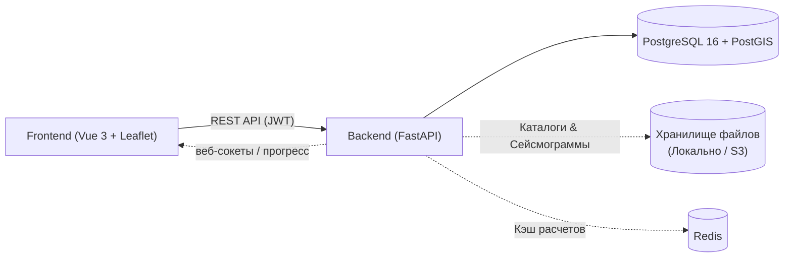
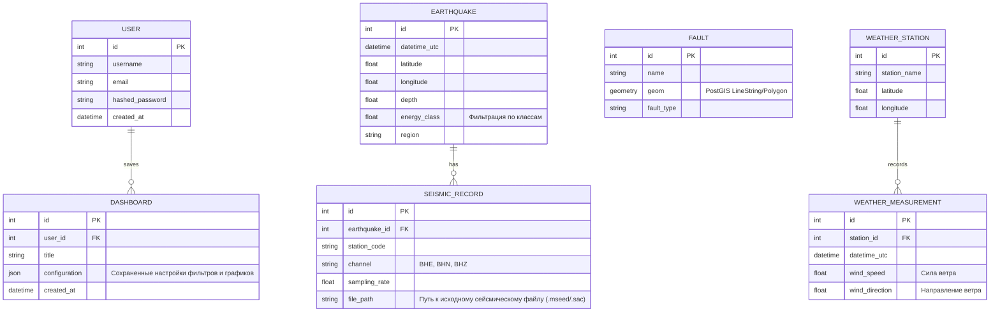

# Паспорт архитектуры и стека

**Vue.js + Python FastAPI + Postgres**

---

## 1. Схема системы



## 2. Стек


| Слой | Технология |
|---|---|
| Фронтенд-фреймворк | Vue 3 |
| Архитектура фронтенда | Модульная архитектура |
| Язык фронтенда | TypeScript |
| Сборка | Vite |
| Роутинг | Vue Router 4 |
| Состояние | Pinia |
| HTTP-клиент | axios |
| Библиотека компонентов | `[Element Plus / Leaflet]` |
|---|---|
| Бэкенд-фреймворк | Python FastAPI |
| Валидация | Pydantic v2 |
| ORM | SQLAlchemy 2.0 (async) |
| Миграции | Alembic |
| Аутентификация | JWT (`PyJWT`) + `passlib[argon2]` |
| Расчетный стек | `[ObsPy / NumPy / SciPy / GeoPandas]` |
|---|---|
| БД | PostgreSQL 16 (+ PostGIS) |


## 3. Фронтенд архитектура

```
frontend/
    src/
```

## 4. Бэкенд архитектура

```
backend/
```

## 5. Модель данных

